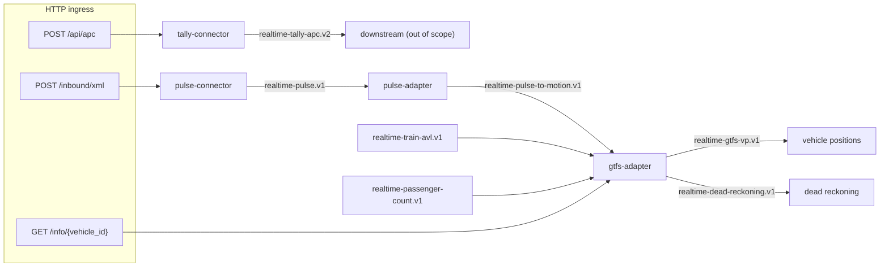

# Omnia Exemplar

A reference implementation for building [omnia](https://github.com/augentic/omnia)
services. It models a fictional transit operator ("Acme") that consolidates
realtime vehicle data processing into a WASM guest: SOAP/XML position feeds,
passenger counting, and GTFS realtime adaptation.

Domain logic lives under `crates/*` as plain axum handlers
(`pub async fn name<P>(Context<P>, Json<Input>)`) and messaging handlers
(`pub async fn name<P>(Context<P>, Input)`), and each crate exposes its
wiring: `handlers()`, an `api::Handlers` binding its paths to its fns
(`post(tally)`) and its topics to its consumers. The **guest is the
workspace root package** (`src/lib.rs`) — one `<stem>::handlers(),` entry per
crate in `router`, merged by `Handlers::from` and closed with `with_state`
over a provider-owning `Client`, bound as the WASI exports by
`http::export!(router)` and `messaging::export!(router)`.
Match this layout when creating a new Omnia service: root `src/`, not a
`guests/<name>/` tree.

## Relation to omnia

This repository is the application-scale complement to the
[omnia](https://github.com/augentic/omnia) runtime's per-capability
[`examples/`](https://github.com/augentic/omnia/tree/main/examples): one real
service instead of twenty snippets. The guest is built on the `omnia-sdk`
SDK (async handler fns behind capability traits) and exercises
`wasi:http`, `wasi:messaging`, `wasi:keyvalue`, `wasi:config`,
`wasi:identity`, and — through the `crates/capability` routes the
root guest mounts under `/examples/*` — blobstore, websocket broadcast,
docstore, and SQL. Two capabilities get a deeper treatment:
`crates/docstore` and `crates/sql` rebuild the rich
docstore and SQL examples that omnia trimmed from its own `examples/` tree
(commit `c4666ca`, "Example tidy"), rewritten as typed handlers — portable
and optional docstore filters, parameterized SQL queries into `FromRow` records,
a JOIN entity, and server-assigned ids. The example host (`examples/runtime.rs`) is a single
`omnia::runtime!` invocation wiring every capability the guest imports —
including `WasiBlobStore` and `WasiWebSocket` — to the in-tree default
backends; swapping in production backends from
[omnia-backends](https://github.com/augentic/omnia-backends) is a host-side
change only (see the omnia
[Production Backends guide](https://github.com/augentic/omnia/blob/main/docs/guides/production-backends.md)).
The omnia crates are crates.io dependencies (currently 0.38.0) declared once
under `[workspace.dependencies]` in `Cargo.toml`; every `omnia-*` line moves
together. Outbound HTTP caching is opt-in per call site through
`omnia-http-cache` (from
[omnia-ext](https://github.com/augentic/omnia-ext), 0.36.0), an
`HttpClient` decorator that stores responses in the provider's `StateStore`
(see `crates/gtfs-adapter`).

## Quick start

```shell
# build the guest
cargo build --target wasm32-wasip2 --release

# run it with the example host runtime
cp .env.example .env   # then fill in values
set -a; source .env; set +a
cargo run --example runtime -- run target/wasm32-wasip2/release/guest.wasm
```

## Architecture



Two shapes of service repeat throughout the pipeline:

- **Connector** — thin ingress: decode the transport payload, validate it,
  key it, and publish it to a topic. No enrichment, no state.
  `tally-connector` is the minimal template; `pulse-connector` adds a
  vendor-specific (SOAP/XML) transport.
- **Adapter** — domain transformation: validate, enrich via upstream APIs,
  maintain state, and publish derived events. `pulse-adapter` is a compact
  example; `gtfs-adapter` is the full-size one.

Start a new service from the closest template.

Three words recur through this guide:

- A **stem** is one crate under `crates/`, one service of the pipeline
  above, exposing its `handlers()`.
- A **part** is one module of a stem, binding its routes and topics in its
  own `handlers()`, which the stem's `handlers()` merges.
- A **rung** is one of the three test tiers under [Testing](#testing).

The guest template's own terms, a *slice* and *drift*, are defined in
[`templates/guest/README.md`](templates/guest/README.md).

## Guest packaging

The root `Cargo.toml` is both the workspace and the deployable guest package
(`name = "guest"`, `crate-type = ["cdylib", "rlib"]`). Workspace members are
`crates/*` (plus `templates/guest`, the guest template as a crate, and
`templates/check`, its gate). There is no
`guests/` directory.

The guest:

- Merges each crate's `handlers()` — plain axum routes
  (`axum::routing::{get, post}` over `Path`, `Query`, and `Json`
  extractors, with `Bytes` for non-JSON wire formats) and topics bound to
  consumers on an `api::Handlers` — once in `router`, closing it with
  `with_state` into the one `omnia_sdk::api::Router` that serves HTTP
  requests and dispatches messaging deliveries
- Binds the router to each WASI export: `http::export!(router)` and
  `messaging::export!(router)`
- Uses `omnia_sdk::WasiProvider`, the zero-sized provider implementing every
  capability trait over its WASI-backed default methods on `wasm32`; the
  stems reach nine of them (`BlobStore`, `Config`, `DocumentDb`,
  `HttpClient`, `Identity`, `Publisher`, `SqlDb`, `StateStore`, `WebSockets`)
- Bounds the router with each stem's `Requires`, one `where` predicate per
  stem
- Routes both transports through one provider-owning `Client` per request,
  keeping `wasmtime` and `omnia-core` off the native non-dev dependency graph
  (enforced by `deny.toml`)

## Routes and topics

| HTTP route | Handler |
| --- | --- |
| `POST /api/apc` | `tally_connector::tally` — passenger-count ingress |
| `POST /inbound/xml` | `pulse_connector::pulse` — SOAP/XML position ingress |
| `GET /info/{vehicle_id}` | `gtfs_adapter::vehicle_info` |
| `POST /god-mode/set-trip/{vehicle_id}/{trip_id}` | `gtfs_adapter::set_trip` (requires the `god-mode` feature) |
| `GET/POST /examples/stops`, `GET/PUT/DELETE /examples/stops/{id}` | `docstore::{list_stops, create_stop, get_stop, upsert_stop, delete_stop}` — docstore CRUD plus filtered queries |
| `GET/POST /examples/routes`, `GET /examples/routes/{id}` | `docstore::{list_routes, create_route, get_route}` — OR / `in_list` / negation filters |
| `GET/POST /examples/stop-times`, `GET /examples/stop-times/{id}` | `docstore::{list_stop_times, create_stop_time, get_stop_time}` — string and numeric range filters |
| `GET/POST /examples/agencies`, `GET/PATCH /examples/agencies/{id}` | `sql::{list_agencies, create_agency, get_agency, update_agency}` — parameterized SQL CRUD with server-assigned ids |
| `GET/POST /examples/agencies/{agency_id}/feeds` | `sql::{list_agency_feeds, create_feed}` — per-agency feeds with referential checks |
| `GET /examples/feeds`, `DELETE /examples/feeds/{id}` | `sql::{list_all_feeds, delete_feed}` — JOIN listing and delete with 404-on-zero-rows |
| `POST /examples/patterns/decode` | `pattern::decode_segment` — decode-through-cache over `StateStore`, `Config`, and `HttpClient` |
| `PUT /examples/patterns/quotas/{tenant}` | `pattern::update_quota` — optimistic concurrency over `StateStore::compare_and_swap` (`409 Conflict` via `QuotaError`) |
| `GET /examples/patterns/upstream/{resource}` | `pattern::fetch_upstream_status` — bearer-token auth via `Identity::named` and `IdentityExt::access_token` |
| `POST /examples/patterns/places`, `GET /examples/patterns/nearby` | `pattern::{upsert_place, nearby_places}` — `INSERT … ON CONFLICT` upsert (`PlaceError`) and bounding-box + haversine query |
| `POST /examples/archive` | `capability::archive` — `BlobStore` object write |
| `POST /examples/alert` | `capability::alert` — `WebSockets` send to every socket or to the named ones |
| `POST /examples/note` | `capability::note` — `DocumentDb` upsert |
| `POST /examples/reading` | `capability::reading` — `SqlDb` insert |

| Messaging topic | Handler |
| --- | --- |
| `realtime-pulse.v1` | `pulse_adapter::pulse` (XML) |
| `realtime-pulse-to-motion.v1` | `gtfs_adapter::motion` |
| `realtime-train-avl.v1` | `gtfs_adapter::train_avl` |
| `realtime-passenger-count.v1` | `gtfs_adapter::passenger_count` |

`POST /api/apc` publishes to `realtime-tally-apc.v2`; its downstream
consumer is out of scope for the exemplar.

## Crate map

| Crate | Role |
| --- | --- |
| `crates/common` | The topic table (`common::topic`) a publishing stem and its consumer both name |
| `crates/pulse-connector` | HTTP ingress for the vendor "Pulse" SOAP/XML position feed; republishes to messaging |
| `crates/pulse-adapter` | Converts Pulse train updates into Motion location events |
| `crates/tally-connector` | HTTP ingress for the vendor "Tally" passenger-count feed |
| `crates/gtfs-adapter` | Converts Motion events into GTFS-realtime vehicle positions |
| `crates/capability` | Domain-free handlers proving the remaining capabilities: `BlobStore`, `WebSockets`, `DocumentDb`, `SqlDb`; mounted by the guest at `POST /examples/{archive,alert,note,reading}` |
| `crates/docstore` | Rich `wasi:docstore` showcase: GTFS-like collections exercising portable and optional filters, sorting, and continuation pagination |
| `crates/sql` | Rich `wasi-sql` showcase: agency/feed schema exercising parameterized SQL, `FromRow` records through `query_as`, a JOIN entity, and server-assigned ids |
| `crates/pattern` | Composition patterns: decode-through-cache, `StateStore::compare_and_swap` optimistic concurrency (`409`), named-identity bearer auth, relational geo queries, and structured JSON error bodies |
| root package (`guest`) | Typed-router HTTP + exact-topic messaging WASM guest binary |

Domain crates depend only on the `omnia-sdk` capability traits, each naming
the ones its handlers reach in its `Requires` (`Config`, `HttpClient`,
`Identity`, `Publisher`, and `StateStore` in the pipeline; `BlobStore`,
`DocumentDb`, `SqlDb`, and `WebSockets` in the showcases), so the same code
runs inside the WASM guest and against `omnia_test::guest::Provider` doubles
in tests. `omnia-http-cache` is written against those traits
(`HttpCache<H: HttpClient, S: StateStore>`), so `gtfs-adapter`'s cached
clients stay provider-generic.

## Adding a new handler

1. Pick a template: `tally-connector` for a connector, `pulse-adapter` for an
   adapter.
2. Create the crate under `crates/` and add `<stem> = { path = "crates/<stem>" }`
   to `[dependencies]` in the root `Cargo.toml`.
3. Implement the `pub` input and reply types and a handler fn with the
   narrowest capability bounds it needs (e.g. `P: Config + Publisher`).
   An HTTP handler is a plain axum handler taking `Context<P>` as an
   extractor alongside axum's own
   (`pub(crate) async fn name<P>(context: Context<P>, Json(input): Json<Input>) -> Result<Json<Reply>>`);
   a messaging handler takes the same context first, then its decoded input
   (`pub(crate) async fn name<P>(context: Context<P>, input: Input) -> Result<Reply>`).
   Read a capability through the context's accessor for it (`context.state()`,
   `context.sql()`, `context.http()`, ...).
4. Declare the path as a `pub(crate) const` of the part that uses it, its
   required configuration as one `#[derive(Settings)]` struct (whose `KEYS`
   `tests/component.rs` seeds), and any new topic in `common::topic`.
5. Bind the handler in the part's `pub(crate) fn handlers()`
   (`Handlers::new().route(PATH, post(handler))`; a custom status code
   or wire format is an `IntoResponse` on the reply or error type; or
   `.topic(topic::X, handler)`, or `.topic_with(topic::X, handler, decode)`
   for a non-JSON payload), and list the part in the stem's `src/lib.rs`
   (`Handlers::from([..])`). A capability trait the handler newly reaches
   joins the stem's `Requires`.
   A new stem declares its `Requires`, then adds `P: <stem>::Requires,` to
   the `where` list of `router` in `src/lib.rs` and its `<stem>::handlers(),`
   line to the `Handlers::from([..])` list.
6. Add fixtures under the crate's `data/` and native tests under `tests/`
   that seed an `omnia_test::guest::Provider` with the doubles the
   handler's capabilities read and drive the stem's `handlers()`.
7. Run `mise run ci` — fmt-check, clippy (native + wasm), tests, docs, vet, deny.

## Configuration

Every domain configuration key is declared beside the part that reads it,
and `.env.example` carries sample values. Environment-specific topic
prefixing is a host-side messaging backend concern (`KAFKA_TOPIC_PREFIX` /
`NATS_TOPIC_PREFIX`), so guests address logical topic names directly.

| Key | Used by | Purpose |
| --- | --- | --- |
| `BLOCK_MGT_URL` | gtfs-adapter, pulse-adapter | Block Management API base URL |
| `FLEET_URL` | gtfs-adapter | Fleet API base URL |
| `TRIP_MANAGEMENT_URL` | gtfs-adapter | Trip Management API base URL |
| `STATIC_API_URL` | pulse-adapter | Static GTFS API base URL |
| `API_IDENTITY` | gtfs-adapter, pulse-adapter | Identity used to acquire access tokens for the operator APIs |
| `GOD_MODE_ENABLED` | gtfs-adapter | Runtime switch for the god-mode override (also requires the `god-mode` build feature) |
| `PATTERN_DECODER_URL` | pattern | Decoder endpoint for the decode-through-cache example |
| `PATTERN_CLIENT_CERT` | pattern | Client certificate forwarded to the decoder as a `Client-Cert` header |
| `PATTERN_UPSTREAM_URL` | pattern | Upstream base URL for the bearer-token authentication example |
| `PATTERN_UPSTREAM_IDENTITY` | pattern | Identity used to acquire access tokens for the upstream status example |

`WEBSOCKET_ADDR` in `.env.example` is read by the example host, not the
guest: it is the bind address for `WebSocketDefault` (the backend behind
`POST /examples/alert`), which otherwise defaults to `0.0.0.0:80`.

## State keys

The gtfs-adapter keeps its pipeline state under the `motionGtfs.` prefix,
namespaced by purpose then identifier — see `crates/gtfs-adapter/src/state_keys.rs`
for the full catalog and key builders. God-mode overrides live under a
separate `god_mode.` prefix so operational overrides never mix with pipeline
state.

A key built from an HTTP request value is portable: `.`-separated segments
of ASCII letters, digits, `_`, and `-`. The value is checked first, and one
that is not portable is refused with a `400` (`gtfs_adapter::vehicle_info`,
`pattern::cas`, `pattern::decode`). The messaging handlers build keys from
the feeds' identifiers unchecked, so a store that holds only portable keys
may refuse one with `invalid`.

## Copy this, not that

Patterns worth copying into new services:

- Handler fns behind capability traits (plain axum handlers taking
  `Context<P>` for HTTP, `async fn(Context<P>, Input)` for messaging),
  each crate binding its own to its paths and topics in `handlers()`,
  with the guest as a thin composing layer at the **workspace root**
  (`src/lib.rs`), one line per crate in `router`.
- One topic table (`common::topic`) a producer and its consumer both
  name, so they agree by construction.
- Per-part configuration as one `#[derive(Settings)]` struct, loaded at
  use (`<Part>Settings::load(context.config())`), its `KEYS` the list the
  component rung seeds.
- Native tests under `omnia_test::guest::Provider` doubles plus captured fixtures
  (`tests/` + `data/` in each crate), each crate driving its own `handlers()`,
  and a rung per router at the root (`tests/routes.rs`,
  `tests/messaging.rs`) that builds the composed whole.
- Decode-through-cache: expensive lookups go through `StateStore` in one
  handler — `get_json` miss → `Settings` → `fetch_json` → `set_json` with
  a TTL — instead of a separate cache-population process
  (`pattern::decode`, `pulse_adapter::stops`).
- Optimistic concurrency (`StateStore::compare_and_swap`): versioned state
  updates map a `Conflict` to `409 Conflict` through a module error type's
  `IntoResponse` (`pattern::cas`).
- Upstream bearer-token authentication (`IdentityExt::access_token`):
  resolve the identity name from the part's `Settings`, acquire a token via
  `Identity::named(..).access_token()`, and send
  `Authorization: Bearer <token>` on `HttpClientExt::fetch_json`
  (`pattern::identity`).
- Cached upstream fetches as an explicit decorator, not an ambient runtime
  feature: `HttpCache::new(provider, provider).fetch(request)` at the call
  sites that want it (`gtfs_adapter::fleet::vehicle`,
  `gtfs_adapter::block_mgt::cached_allocation`), keyed by a quoted
  `If-None-Match` etag, which `HttpCache` hashes into a portable state key,
  with `max-age` as the TTL; every other request uses the bare `HttpClient`
  and sends no cache headers.
- Credential material in `Config`, carried as ordinary request data (the
  `Client-Cert` header), so outbound HTTP stays generic.
- Recording doubles: `MatchedHttp` answers only the exact requests a test
  seeds and records what left the guest — shape, headers, and call count
  (`crates/pattern/tests/decode.rs`).
- Radius queries as bounding-box `SELECT`s through `SqlDbExt::query_as`
  into `FromRow` records, refined by haversine in Rust — never a geospatial
  extension bolted onto the KV state store (`pattern::place`).
- Structured JSON error bodies: the handler owns its error type and its
  `IntoResponse` serializes it as `application/json`, extending the
  framework's fixed two-field `ErrorBody` envelope (`error`, `message`)
  with the variant's domain
  fields — `{"error": "invalid_coordinate", "message": …, "field": …,
  "value": …, "min": …, "max": …}` (`pattern::place::PlaceError`).

Acme domain quirks that are **not** general patterns:

- **Duplicate publish** — `pulse-adapter` publishes each Motion event twice
  (`PUBLISH_REPEATS`) because a downstream schedule-adherence process needs
  the repeat. The legacy system also spaced the repeats with a blocking
  sleep; that was removed — never block a WASM guest.
- **God-mode** — an operational override tool, off by default behind the
  `god-mode` cargo feature and the `GOD_MODE_ENABLED` config key. Not part of
  a production pipeline.
- **SOAP fault as the handler error** — `pulse-connector` rejects requests
  with a pre-rendered XML `<Fault>` (its `IntoResponse` puts the XML on
  the wire as `text/xml`)
  because the vendor protocol demands it, and parses the envelope inside the
  handler so even malformed bodies get the fault. Prefer plain structured
  errors unless a wire protocol dictates otherwise.
- **UTC as the local timezone** — `TIMEZONE` in `gtfs-adapter` and
  `pulse-adapter` is UTC to keep fixtures reproducible. A real operator sets
  its actual IANA zone.
- **Legacy reply fields** — `VehicleInfoReply::pid` and
  `SetTripReply::process` are always `0`, retained only to match the legacy
  reply shapes.

## Testing

```shell
mise run test              # cargo nextest run --workspace --all-features --locked
```

The suite is laid out as omnia's three rungs (see omnia's
[Testing Omnia-Based Code](https://github.com/augentic/omnia/blob/main/docs/guides/testing-omnia-code.md)
guide). Everything runs under
`mise run test`: nothing is `#[ignore]`d, and nothing needs installing
beyond `rust-toolchain.toml`, which carries the `wasm32-wasip2` target the
component rung compiles for. Unit tests belong beside the logic they cover
(`#[cfg(test)]` in `src/`); today every check is a handler-level test or
above, so the rungs below are the whole suite.

### Handler rung

Every crate tests its handlers natively against `omnia_test::guest::Provider`,
which implements every capability trait over one default double each —
`MapConfig`, `Sink`, `MatchedHttp`, `Memory`, `MemoryDocs`, `ScriptedTables`,
`FixedIdentity`. The handler's bounds pick out which doubles a test seeds
through the same-named builders (`.config(..)`, `.http(..)`, `.tables(..)`),
and assertions read the `pub` fields (`provider.publish.sent()`). There is no
hand-written mock provider anywhere in the workspace. A test builds the
stem's router once, `handlers().with_state(Client::new(provider.clone()))`,
and drives it with `omnia_test::guest::send(&router, request)` for one request
(the reply comes back with its body collected) or
`omnia_test::guest::deliver(&router, topic, payload)` for one delivery; a
file's own helper, where it has one, builds the request shape its scenarios
share and calls `send` inside.

- `tests/routes.rs`, `tests/messaging.rs` — the root guest's production
  routers built natively under the production capability list as doubles.
  Building is the check: axum and the messaging router panic where two
  crates claim one route or topic, and an unknown path or topic is refused
- `crates/tally-connector/tests` — the minimal handler test driven through
  `tally_connector::handlers()`
- `crates/pulse-connector/tests` — SOAP happy path and fault sad path driven
  through `pulse_connector::handlers()`
- `crates/gtfs-adapter/tests` — `MatchedHttp` seeded with the exact
  upstream URLs (`tests/support/`), covering motion, dead reckoning,
  sign-on, outdated/future timestamp rejection, filtering, occupancy, the
  non-portable vehicle id's `400`, and (feature-gated) god-mode
- `crates/pulse-adapter/tests` — static fixtures plus replay sessions
  captured from a live system (`data/replay`, `data/static`), loaded by
  `tests/fixture/` onto `MatchedHttp`
- `crates/capability/tests` — one provider covering
  `BlobStore`/`WebSockets`/`DocumentDb`/`SqlDb`
- `crates/docstore/tests` — `MemoryDocs`, the filter-evaluating
  `DocumentDb` double, covering how each list handler maps its query
  parameters onto filters, the stop name sort, continuation forwarding, and
  the CRUD round-trip with its duplicate-create `409`
- `crates/sql/tests` — `ScriptedTables` scripting each parameterized SQL
  query's rows and recording every statement, covering `SELECT`, `INSERT`,
  dynamic `UPDATE`, `DELETE` with 404-on-zero-rows, the missing-agency 404s,
  the JOIN listing, and server-assigned ids
- `crates/pattern/tests` — `MatchedHttp`, `Memory`, `ScriptedTables`,
  `FixedIdentity`, and `MapConfig` covering the decode cache (hit and miss),
  the versioned quota write's stale-version `409`, the non-portable tenant
  and code `400`s, named-identity bearer auth, the nearby query, and the
  upsert with its structured-error rejection
- `templates/guest/tests` — the template crate's contract: a tree
  scaffolded once, its static files held and restored, its root manifest
  held around its stem list
- `templates/check/tests` — the template contract gate and the scaffold
  proof (a rendered guest lints, tests, and builds for `wasm32-wasip2`)

### Component rung

The handler rung never executes the assembled artefact; `tests/component.rs`
does. The root `build.rs` (`omnia_test::build::Components`) compiles this
package for `wasm32-wasip2` on every native build — dev profile, default
features, `god-mode` off — into `target/wasm32-fixtures`, a sibling of the
profile directory shared by every outer profile, feature set and build-script
hash (so no per-hash copies accumulate), and generates the `COMPONENT_GUEST`
path constant the test `include!`s. The test pulls in
`examples/runtime.rs` as a module, so the `Hooks` its `omnia::runtime!`
generates — the exact host rows the example binary links — assemble the
runtime through `omnia_test::host::Deployment` over `Backends`, the
in-memory host defaults. A host the guest imports but the example does not
declare fails here at link time, before any scenario runs.

Each scenario drives one trigger export in-process and asserts the side
effect on the backends, leaving payload semantics to the handler rung:

- `component::http_export` — `HttpHandler` posts the tally fixture to
  `/api/apc` and requires exactly one message on the broker, on
  `realtime-tally-apc.v2`
- `component::messaging_export` — `MessagingHandler` delivers a
  passenger-count record and requires an occupancy-status entry in the
  `wasi:keyvalue` bucket, read through `Backends::state`

No port opens and no `.env` is read: `Backends::defaults()` reads no
environment variable and connects nothing, so the rung is deterministic.
The example host (`examples/runtime.rs`) is a server that never exits, so
it is compiled, not run: here as the `production` module, and as an example
target by `make lint`.

## Guest template contract

This repository is the source of truth for the reusable Omnia guest
tooling. [`templates/guest/manifest.yaml`](templates/guest/manifest.yaml)
maps repository files to consumer scaffold targets, and the
`omnia-template` crate beside it ([`templates/guest`](templates/guest))
embeds the same map as Rust, every body compiled in
([contract and authoring rules](templates/guest/README.md)).

The Emery omnia target adapter depends on the crate at a pinned commit of
this repository and scaffolds the template from it at build time: `exact`
manifest entries are the repository-root files themselves, read in place
through `include_str!`, and seed baselines live under
`templates/guest/core/`. There is no hand-vendored copy anywhere.
**Merges to `main` are therefore release acts**: the CI gate (including
the template contract check below) is required on merge, not advisory,
because every commit a consumer may pin must be a green one.

The gate pins an exact `schema-version` for
`templates/guest/manifest.yaml`; the adapter reads the crate, so a bump
here lands with the table change it describes and reaches a consumer with
its pin.

The contract is enforced by the `template-check` gate, which runs
inside the standard test suite and stand-alone:

```shell
cargo run -p template-check   # schema, path safety, seed pins and patches, clippy parity, the crate's table
```

`exact` entries reference their repository-root file in place
(`source == target`), so a green root vouches for the
scaffold with no diff to maintain. The seeds give a new service the shape
above — the root package as the component composing every stem's
provider-generic routers, `rlib` alongside `cdylib`, the two rungs under
`omnia_test::guest::Provider`, a `common` crate for the capability bound
and the topic table every stem shares, and the local host behind the
`host` feature — and the suite's
scaffold test renders the manifest and lints, tests, and builds the
result against the same published omnia the exemplar uses. To move to a
new omnia release, bump every `omnia-*` line in `[workspace.dependencies]`
together (and the omnia-ext crates to their matching release),
re-resolve `Cargo.lock`, and bump the seed's pins, which the gate holds
equal to the workspace's.

## Development

Tasks run through [mise](https://mise.jdx.dev/getting-started.html), which
must be installed by hand; `make <task>` is a pass-through to
`mise run <task>` and fails, rather than installing it, when it is missing.

```shell
mise run ci     # fmt-check, clippy (native, then wasm32-wasip2), test, test-docs, docs, vet, deny — same gate as omnia
mise run check  # local advisories: audit, fmt (in place), lint, outdated, deps
```

`mise run ci` is the whole gate and runs exactly the jobs of the CI workflow:
every rung above, including the component rung and the template contract
gate, runs inside `mise run test`. `mise tasks` lists
everything else; the generic Rust tasks are included from
[`augentic/toolkit`](https://github.com/augentic/toolkit/blob/main/mise/rust.toml)
by `mise.toml`, which adds only the `wasm` release build of the guest.
`mise.toml` is itself an `exact` entry of the guest template contract, so it
stays free of exemplar-only tasks.

Clippy runs twice: natively with `--all-targets`, then for `wasm32-wasip2`
over libs, bins and examples only (never tests or benches). The whole
workspace is in the wasm32 scope — the guest, the handler crates, the
std-only `omnia-template` crate and its `template-check` gate — so the host
in `examples/runtime.rs` stays
`cfg_select!`-gated to an empty `main` on wasm32. Regenerate the supply-chain files
with `mise run vet-regen`; `vet` itself only checks.

To run the host for real — a manual check, not a test — build the release
guest and start the example runtime against it:

```shell
mise run wasm && cargo run --example runtime -- run target/wasm32-wasip2/release/guest.wasm
```

The workspace follows omnia's conventions: stable toolchain
(`rust-toolchain.toml`, with the `wasm32-wasip2` target), edition 2024,
workspace lints, `cargo vet` supply-chain audits (`supply-chain/`), and CI as
thin wrappers over the reusable workflows in `augentic/toolkit`, pinned to a
release tag.

Dependency on omnia is strictly one-way: the omnia crates and
`omnia-http-cache` (from
[omnia-ext](https://github.com/augentic/omnia-ext)) are
published crates.io dependencies declared once under `[workspace.dependencies]`
and bumped together.
